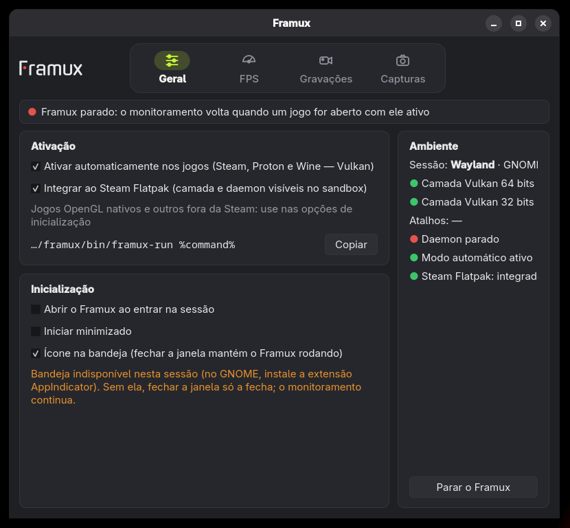
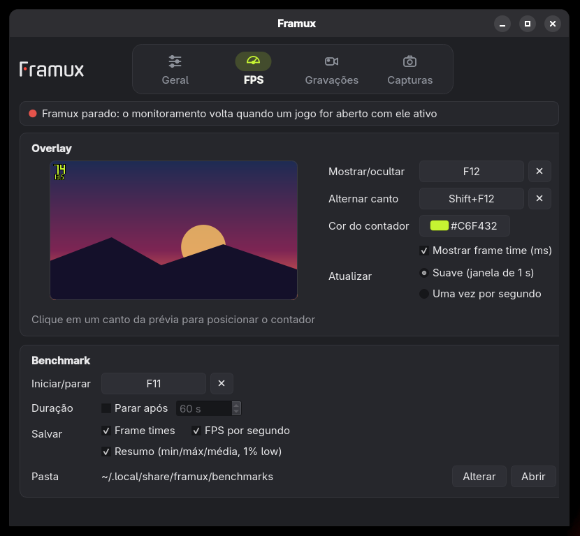
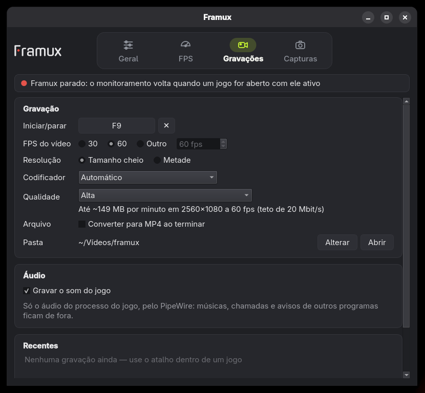
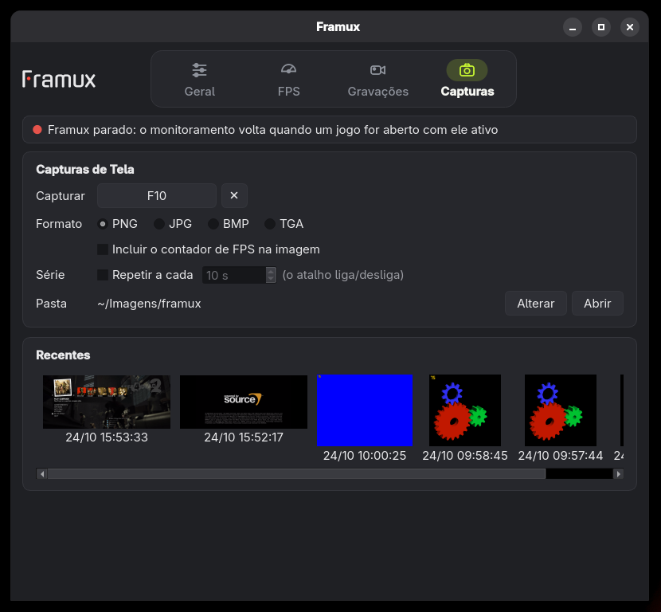

<p align="center">
  
</p>

<h1 align="center">Framux</h1>

<p align="center">
  <b>Contador de FPS, benchmark, screenshots e gravação de jogos — uma alternativa inspirada no FRAPS, nativa para Linux.</b><br>
  A interface simples e direta do clássico FRAPS, mas com gravação moderna: codificação pela placa de vídeo,<br>
  arquivos compactos e baixo impacto no desempenho do jogo.
</p>

<p align="center">
  
  
  
  <br>
  
  
  
  
  
</p>

<p align="center">
  <a href="#destaques">Destaques</a> ·
  <a href="#instalação">Instalação</a> ·
  <a href="#uso">Uso</a> ·
  <a href="#gravação">Gravação</a> ·
  <a href="#steam-flatpak">Steam Flatpak</a> ·
  <a href="#configuração">Configuração</a> ·
  <a href="#estado-do-projeto">Estado</a> ·
  <a href="#compilar">Compilar</a> ·
  <a href="#arquitetura">Arquitetura</a> ·
  <a href="#decisões-de-implementação">Decisões</a>
</p>

<br>

<table>
  <tr>
    <td width="25%" valign="top">
      <h3>🎯 Simples como o FRAPS</h3>
      Contador no canto da tela, F9 grava, F10 captura, F11 mede, F12 mostra/oculta. Sem painéis, sem distração.
    </td>
    <td width="25%" valign="top">
      <h3>⚡ Leve no jogo</h3>
      Conversão de cor na GPU, codificação por NVENC/VA-API e um jogo que nunca espera o encoder: sem slot livre, o quadro é descartado.
    </td>
    <td width="25%" valign="top">
      <h3>🎮 Funciona com tudo</h3>
      Vulkan, OpenGL e Direct3D via Proton/DXVK/VKD3D/WineD3D, em X11 e Wayland, jogos de 64 e 32 bits, inclusive o Steam Flatpak.
    </td>
    <td width="25%" valign="top">
      <h3>📊 Benchmark de verdade</h3>
      Frame times em CSV, FPS por segundo, médias, percentis p50–p99, 1 % e 0,1 % low, com API, camada e GPU registradas.
    </td>
  </tr>
</table>

<br>

## Destaques

<table>
  <tr>
    <td width="50%" valign="top">
      
      <h3>Liga uma vez, vale para todos os jogos</h3>
      Com o <b>modo automático</b>, todo jogo da Steam, Proton ou Wine que usa Vulkan (o que inclui Direct3D via DXVK/VKD3D) ganha o contador sem configurar nada. Os demais apps Vulkan ficam intocados.
    </td>
    <td width="50%" valign="top">
      
      <h3>Overlay discreto</h3>
      Só o número de FPS, em fonte de segmentos própria, no canto que você escolher clicando na prévia. Fica vermelho enquanto grava, e o vídeo sai sem ele.
    </td>
  </tr>
  <tr>
    <td width="50%" valign="top">
      
      <h3>Gravação moderna</h3>
      AV1 ou H.264 pela placa de vídeo, SVT-AV1 ou x264 pelo processador, ou Ut Video sem perda. MKV que sobrevive a travamentos, MP4 por remux e o áudio <i>só</i> do jogo, via PipeWire.
    </td>
    <td width="50%" valign="top">
      
      <h3>Screenshots fiéis</h3>
      PNG, JPEG, BMP ou TGA, com ou sem o contador, em série a cada N segundos. Swapchains de 10 bits e HDR (FP16) geram PNG de 16 bits.
    </td>
  </tr>
</table>

<br>

## Instalação

Os RPMs da última versão (Fedora 44) ficam em [`rpm/`](rpm/):

| Pacote                             | Conteúdo                                                |
| ---------------------------------- | ------------------------------------------------------- |
| `framux-<versão>.x86_64.rpm`       | janela, CLI, daemon, unidades systemd do usuário, ícone |
| `framux-layer-<versão>.x86_64.rpm` | camada Vulkan e shim OpenGL para jogos 64 bits          |
| `framux-layer-<versão>.i686.rpm`   | o mesmo para jogos 32 bits (ex.: Left 4 Dead 2 nativo)  |

Instale os três juntos (as dependências, como `ffmpeg-free` e `pipewire`, vêm do repositório do Fedora):

```sh
git clone https://github.com/viniciussoaresbr/framux.git && cd framux
sudo dnf install ./rpm/framux-*.x86_64.rpm ./rpm/framux-layer-*.i686.rpm
```

Depois:

1. abra **Framux** no menu de aplicativos (isso habilita o `framuxd.socket` e, com o Steam Flatpak integrado, renova as cópias da camada);
2. feche e abra o Steam e os jogos que estavam abertos.

**Atualizar:** rode o mesmo comando com os RPMs novos (`sudo dnf reinstall` se a versão for a mesma).
**Remover:** `framux flatpak disable` (se integrou ao Steam Flatpak) e `sudo dnf remove framux framux-layer`.
**Do código-fonte:** veja [Compilar](#compilar).

## Uso

Abra **Framux** no menu de aplicativos (ou `framux` sem argumentos). Na aba **Geral**, ligue _Ativar automaticamente nos jogos_ e saia/entre na sessão uma vez. Jogos OpenGL nativos ou fora da Steam usam `framux run %command%` nas opções de inicialização.

### Atalhos

| Tecla                           | Ação                            |
| ------------------------------- | ------------------------------- |
| <kbd>F9</kbd>                   | inicia/para a gravação          |
| <kbd>F10</kbd>                  | screenshot                      |
| <kbd>F11</kbd>                  | benchmark                       |
| <kbd>F12</kbd>                  | mostra/oculta o overlay         |
| <kbd>Shift</kbd>+<kbd>F12</kbd> | leva o overlay ao próximo canto |

Tudo pode ser trocado na janela: clique no botão do atalho e pressione a tecla ou combinação (<kbd>Esc</kbd> cancela; botão do meio e laterais do mouse também valem).

**O que o overlay mostra:** no primeiro segundo do benchmark, uma caixa verde; depois o contador some e, ao terminar, o FPS médio aparece em branco sobre vermelho por 1 s. Screenshots piscam a caixa em branco. Enquanto grava, o contador fica vermelho e o ícone da bandeja ganha um selo vermelho.

### A janela

| Aba       | O que tem                                                                                                                                                                                            |
| --------- | ---------------------------------------------------------------------------------------------------------------------------------------------------------------------------------------------------- |
| Geral     | modo automático, abrir ao entrar na sessão, iniciar minimizado, bandeja; à direita, o estado do ambiente e "Parar o Framux"                                                                          |
| FPS       | prévia clicável do canto do overlay, atalhos, cor do contador, frame time, modo de atualização; benchmark: atalho, duração, arquivos, pasta                                                          |
| Gravações | atalho, FPS do vídeo (30/60/outro), tamanho cheio ou metade, codificador (os que faltam aparecem desabilitados, com o motivo), qualidade, converter para MP4, pasta, som do jogo, gravações recentes |
| Capturas  | atalho, formato (PNG/JPG/BMP/TGA) e qualidade, incluir contador, série a cada N s, pasta e miniaturas                                                                                                |

As alterações vão para o `config.toml` na hora e chegam aos jogos já abertos. Fechar a janela não para o monitoramento: com bandeja, o Framux fica no ícone (no GNOME, a bandeja exige a extensão AppIndicator).

### Linha de comando

```sh
framux run vkcube                     # qualquer jogo/comando
framux run %command%                  # opções de inicialização da Steam
framux status                         # sessões, FPS, backend de hotkeys
framux bench start --duration 60      # ou F11 no jogo
framux shot --overlay                 # ou F10 no jogo; imprime o caminho do arquivo
framux rec start|stop|toggle          # ou F9 no jogo; grava o jogo ativo
framux overlay toggle|next|hide|show  # F12 / Shift+F12
framux doctor                         # diagnóstico do ambiente
framux flatpak status|enable|disable  # integração com o Steam Flatpak
framux config default                 # config padrão comentável
```

> [!NOTE]
> Sem o daemon, o jogo roda normalmente e o contador funciona; F12 e Shift+F12 continuam mostrando/ocultando e trocando o canto, e as demais ações mostram `-`. Quando o daemon sobe, a camada reconecta sozinha.

### Hotkeys por ambiente

| Ambiente                                               | Mecanismo                            | Observação                                                                   |
| ------------------------------------------------------ | ------------------------------------ | ---------------------------------------------------------------------------- |
| Sessão X11                                             | `XGrabKey` no daemon                 | funciona com qualquer janela em foco; a tecla não chega ao jogo              |
| Wayland (GNOME/KDE) + jogo em XWayland (inclui Proton) | leitura in-game (`xcb_query_keymap`) | só com o jogo em foco; a tecla continua chegando ao jogo                     |
| Jogo com janela Wayland nativa                         | —                                    | ainda sem hotkeys; use a CLI (portal GlobalShortcuts ainda não implementado) |

## Gravação

Gravações em `$XDG_VIDEOS_DIR/framux/<jogo> AAAA-MM-DD HH-MM-SS-cc.mkv` (ou `.mp4` com _Converter para MP4_): vídeo em taxa constante e a trilha "Game" em Opus 48 kHz estéreo. O MKV é escrito durante a gravação, então sobrevive se o jogo travar; o MP4 é um remux dele ao parar, sem recodificar (Ut Video fica em MKV). Uma notificação mostra o arquivo, a duração e o tamanho.

| Codificador            | Encoders do FFmpeg                                                                      | Observação                                                                                               |
| ---------------------- | --------------------------------------------------------------------------------------- | -------------------------------------------------------------------------------------------------------- |
| Automático             | o primeiro que funcionar: AV1 por hardware, H.264 por hardware, SVT-AV1, x264, Ut Video | detectados ao iniciar o daemon (`framuxd --probe-encoders`)                                              |
| AV1 (placa de vídeo)   | `av1_nvenc` (RTX 40+), `av1_vaapi` (AMD RX 7000+, Intel Arc)                            |                                                                                                          |
| AV1 (processador)      | `libsvtav1`, preset 10                                                                  | sempre no `ffmpeg-free`; ~90 fps em 2560×1080 num i5-9400F                                               |
| H.264 (placa de vídeo) | `h264_nvenc`, `h264_vaapi`                                                              | no Fedora, VA-API exige `mesa-va-drivers-freeworld` (RPM Fusion)                                         |
| H.264 (processador)    | `libx264`                                                                               | só com o FFmpeg do RPM Fusion                                                                            |
| Ut Video sem perda     | `utvideo` em RGB planar, preditor mediana                                               | qualidade _Sem perda_ força este; ~230 fps em 2560×1080 num i5-9400F, 5 GB ou mais por minuto em 1080p60 |

Codificador da placa primeiro, porque grava quase sem CPU; AV1 antes de H.264 quando a placa tem os dois, porque os arquivos ficam menores.

**Teto de taxa.** A qualidade é constante, com teto por resolução e FPS (`src/common/video_rate.h`): 0,12 bit por pixel por quadro na qualidade alta, 0,08 na média e 0,05 na baixa, ~35 % menos em AV1. Em 2560×1080 a 60 fps, H.264 alto fica em até 20 Mbit/s (~150 MB/min), contra 50–65 Mbit/s sem teto em cenas pesadas. A aba Gravações mostra a estimativa para a sua tela.

<details>
<summary><b>Por que o teto importa no Fedora sem RPM Fusion</b></summary>

O `ffmpeg-free` (usado por VLC, Totem e afins) decodifica H.264 só pelo openh264, num núcleo. Num i5-9400F, o H.264 de 2560×1080 a 60 fps sem teto decodificava a 0,53× do tempo real (o vídeo travava no player); com 20 Mbit/s, a 1,4×. AV1 (dav1d) decodifica a 6×. HEVC saiu das opções porque o Fedora não tem decodificador para ele.

</details>

**Áudio só do jogo.** O som vem apenas do processo do jogo (`application.process.id` no PipeWire, inclusive Wine/Proton e o Steam Flatpak): música, chamadas e avisos de outros programas ficam de fora.

**Medindo o custo.** Ao parar, o log do daemon (`journalctl --user -u framuxd`) traz uma linha `medição da gravação`: FPS do jogo (média e 1 % low) nos 10 s antes e durante a gravação, quanto a cópia de cada quadro levou na thread do jogo e quantos núcleos o `framuxd` usou. Junto com a linha `gravação salva` (quadros repetidos e descartados), diz se a gravação está pesando no jogo.

### Benchmarks e screenshots

Benchmarks em `~/.local/share/framux/benchmarks`:

| Arquivo                                     | Conteúdo                                                                                                              |
| ------------------------------------------- | --------------------------------------------------------------------------------------------------------------------- |
| `<jogo> AAAA-MM-DD HH-MM-SS frametimes.csv` | um quadro por linha (`frame,present_ns,frametime_ms,displayed_ns,width,height`)                                       |
| `… fps.csv`                                 | quadros por segundo inteiro                                                                                           |
| `… summary.json`                            | avg/min/max, percentis p50–p99, 1 % e 0,1 % low (`"low_definition":"mean_of_worst"`), API, camada (dxvk/vkd3d/…), GPU |
| `benchmarks.log`                            | uma linha legível por benchmark                                                                                       |

Screenshots em `$XDG_PICTURES_DIR/framux/<jogo> AAAA-MM-DD HH-MM-SS-cc.png`.

## Steam Flatpak

O Steam do Flathub (`com.valvesoftware.Steam`) roda num sandbox que não vê `/usr/lib64/framux`, os manifestos em `/usr/share/vulkan` nem o socket do daemon. Com ele instalado, a aba Geral mostra _Integrar ao Steam Flatpak_ (ou `framux flatpak enable`), que:

- copia camada e shim (64 e, se `framux-layer.i686` estiver instalado, 32 bits) para `~/.var/app/com.valvesoftware.Steam/.local/share/framux` e põe os manifestos em `…/.local/share/vulkan/implicit_layer.d`, onde o loader do sandbox procura;
- acrescenta ao override do usuário (`~/.local/share/flatpak/overrides/`) acesso a `xdg-run/framux` (socket) e `xdg-config/framux` (config), além de `FRAMUX_CONFIG` e, com o modo automático, `FRAMUX=1 FRAMUX_AUTO=1`;
- cria `…/framux/bin/framux-run`, o `framux run` de dentro do sandbox, para jogos OpenGL:

  ```
  ~/.var/app/com.valvesoftware.Steam/.local/share/framux/bin/framux-run %command%
  ```

  (com o caminho absoluto; o botão Copiar da janela já leva assim).

Feche e abra o Steam depois de mudar. As cópias são renovadas quando a janela ou o daemon iniciam; `framux flatpak disable` desfaz tudo e devolve o override como estava.

> [!TIP]
> Left 4 Dead 2 nativo é OpenGL de 32 bits: precisa de `framux-layer.i686` e do `framux-run`, ou da opção `-vulkan` (Vulkan 32 bits, ativado pelo modo automático).

## Configuração

`~/.config/framux/config.toml` (veja [`data/config.toml`](data/config.toml)), com overrides por jogo em `~/.config/framux/games/<exe>.toml` (`wine-<exe>.toml` no Wine/Proton). Mudanças são recarregadas sozinhas.

<details>
<summary><b>Variáveis de ambiente</b></summary>

| Variável                                               | Efeito                                                                                                                                                                                                                                                 |
| ------------------------------------------------------ | ------------------------------------------------------------------------------------------------------------------------------------------------------------------------------------------------------------------------------------------------------ |
| `FRAMUX=1`                                             | ativa a camada Vulkan (o `framux run` exporta)                                                                                                                                                                                                         |
| `FRAMUX_AUTO=1`                                        | modo automático: com `FRAMUX=1` na sessão, a camada só age em jogos (Steam `SteamAppId`/`SteamGameId`, Wine/Proton ou `[filters] include`) e fica transparente nos demais apps Vulkan. A GUI grava os dois em `~/.config/environment.d/90-framux.conf` |
| `DISABLE_FRAMUX=1`                                     | desativa a camada                                                                                                                                                                                                                                      |
| `FRAMUX_CONFIG`                                        | outro arquivo de config                                                                                                                                                                                                                                |
| `FRAMUX_GL_PRELOAD`                                    | caminho do shim GL (padrão `/usr/$LIB/framux/libframux_gl.so`)                                                                                                                                                                                         |
| `FRAMUX_AUTOSTART=0`                                   | `framux run` não inicia o framuxd sozinho                                                                                                                                                                                                              |
| `FRAMUX_NO_GL=1`                                       | `framux run` sem o shim GL (jogos com anti-cheat que recusam `LD_PRELOAD`)                                                                                                                                                                             |
| `FRAMUX_DLSYM=0`                                       | desliga o hook de `dlsym` do shim                                                                                                                                                                                                                      |
| `FRAMUX_DEBUG=1`                                       | mensagens de diagnóstico no stderr do jogo                                                                                                                                                                                                             |
| `FRAMUX_LIBDIR64`, `FRAMUX_LIBDIR32`, `FRAMUX_DATADIR` | origem das cópias do `framux flatpak` (testes e instalação fora do prefixo)                                                                                                                                                                            |

</details>

## Estado do projeto

> [!IMPORTANT]
> O Framux está em **alfa**. Contador, benchmark, screenshots, gravação com o áudio do jogo e a janela de configuração funcionam; loop recording, microfone e áudio do sistema ainda não. Encontrou um problema? Abra uma [issue](https://github.com/viniciussoaresbr/framux/issues) com a saída de `framux doctor`, o jogo, a API (Vulkan/OpenGL/Proton) e sua GPU.

| Marco | Conteúdo                                                                                                       | Estado                                                      |
| ----- | -------------------------------------------------------------------------------------------------------------- | ----------------------------------------------------------- |
| M0    | Meson, testes, CI (container Fedora, lavapipe/llvmpipe), clang-format                                          | ✅                                                          |
| M1    | Camada Vulkan: timestamps, overlay de segmentos, config local, `framux run`                                    | ✅                                                          |
| M2    | Daemon, IPC + ring, benchmark, hotkeys X11 e in-game, CLI                                                      | ✅                                                          |
| M3    | Shim OpenGL (GLX/EGL, `dlsym`), build i686                                                                     | ✅                                                          |
| M4    | Screenshots (staging Vulkan / PBO GL, conversões, PNG/JPEG/BMP/TGA, repetição)                                 | ✅                                                          |
| M5    | Vídeo (NVENC, VA-API, SVT-AV1, Ut Video), MKV/MP4, metade do tamanho, taxa constante, áudio do jogo (PipeWire) | ✅ falta microfone, push-to-talk, áudio do sistema          |
| M6    | Loop recording, zero-copy DMA-BUF, lock fps                                                                    | ⏳ próxima etapa                                            |
| M7    | GUI Qt 6: abas, bandeja, modo automático                                                                       | ✅ falta visualizador de benchmarks, portal GlobalShortcuts |
| M8    | COPR/Flatpak, documentação de usuário                                                                          | 🟡 parcial (RPM pronto)                                     |

O loop recording (`framux loop`, `[hotkeys] loop_save`) ainda responde "indisponível" (o overlay mostra `-`).

### Limitações conhecidas

- O modo automático cobre jogos Vulkan (inclui todo Direct3D via Proton). OpenGL nativo precisa de `framux run`, porque injetar `LD_PRELOAD` na sessão inteira afetaria todos os programas.
- `timing = "displayed"` (present_wait/present timing) ainda não implementado; o benchmark usa o instante do present.
- Jogos com janela Wayland nativa não recebem hotkeys (use a CLI).
- Jogos nativos com anti-cheat podem recusar `LD_PRELOAD` (`FRAMUX_NO_GL=1` ou `[filters]`); a camada Vulkan costuma ser aceita sob Proton.
- Um present com vários swapchains desenha o overlay só no primeiro.

## Compilar

Dependências no Fedora:

```sh
sudo dnf install gcc-c++ meson ninja-build vulkan-headers vulkan-loader-devel \
  vulkan-utility-libraries-devel libX11-devel libxcb-devel mesa-libGL-devel \
  mesa-libEGL-devel libpng-devel libjpeg-turbo-devel systemd-devel \
  tomlplusplus-devel catch2-devel qt6-qtbase-devel libstdc++-static \
  ffmpeg-free-devel pipewire-devel
# testes de integração: xorg-x11-server-Xvfb dbus-daemon vulkan-tools glx-utils
#                       mesa-vulkan-drivers mesa-dri-drivers libXtst-devel
```

```sh
meson setup build && ninja -C build
meson test -C build
meson devenv -C build framux run vkcube   # sem instalar
```

Camada e shim i686 (jogos 32 bits):

```sh
sudo dnf install glibc-devel.i686 libstdc++-devel.i686 libstdc++-static.i686 libX11-devel.i686 \
  libxcb-devel.i686 libXau-devel.i686 mesa-libGL-devel.i686 mesa-libEGL-devel.i686
meson setup build32 --cross-file cross/i686-linux.ini -Dlayer_only=true --libdir=lib
ninja -C build32
```

Sem `qt6-qtbase-devel` a GUI é pulada (`-Dgui=enabled` a torna obrigatória).

**RPM:** [`packaging/framux.spec`](packaging/framux.spec) gera `framux` (GUI, CLI, daemon, unidades systemd user, `.desktop` e ícone) e `framux-layer` (camada + shim + manifesto). Para jogos 32 bits, gere também o `framux-layer.i686` com `rpmbuild -bb --target i686`.

<details>
<summary><b>Testes</b></summary>

`meson test -C build` roda:

- **unit** — contador de FPS (60 Hz, 144 Hz com jitter, pausa, 20 000 fps, borda da janela), estatísticas exatas, formato nativo, conversões BGRA8/RGBA8/A2B10G10R10/A2R10G10B10/FP16, arbitragem de sessão, config, hotkeys, ring, overlay;
- **gl-state** — overlay num contexto GL core com estado "sujo": estado e `glGetError` do jogo intactos, overlay presente na janela;
- **layer-validation** — app Vulkan com a camada e a validation layer Khronos;
- **e2e-\*** — daemon + camada/shim + CLI reais num Xvfb com D-Bus isolado: Vulkan e GL (benchmark e screenshots com/sem overlay), jogo morto no meio do benchmark, daemon caindo/voltando, hotkeys in-game via XTest, modo automático (app comum intocado, jogo da Steam vira sessão), mudança no `config.toml` chegando ao jogo aberto e gravação (Vulkan com MP4 e cor convertida na GPU sob a camada de validação, inteiro e na metade, cores conferidas pixel a pixel; GL em Ut Video na metade do tamanho, jogo morto no meio, F9);
- **recorder** — gravador com quadros e áudio sintéticos: buraco de quadros vira repetição, trilha Opus, duração, remux para MP4, nada de arquivo vazio, cores BT.709 e orientação, NV12 vindo da GPU, pixels exatos no sem perda;
- **audio-capture** — PipeWire + WirePlumber privados: um seno tocado pelo próprio processo é achado pelo PID e capturado;
- **gui** — janela em `QT_QPA_PLATFORM=offscreen` com cliques e teclas simulados: canto pela prévia, atalhos por teclado e mouse, atalho repetido recusado, formato, confirmação Sim/Não, modo automático e recarga de mudança externa.

O build i686 roda `gl-state` e `layer-validation` em 32 bits. `framux-gui --snapshot <pasta>` salva imagens das quatro abas.

</details>

## Arquitetura

```
 jogo                                          framuxd (daemon do usuário)
┌─────────────────────────────────┐  socket   ┌───────────────────────────────┐
│ libframux_vk.so (camada Vulkan) │ SEQPACKET │ sessões, arbitragem de foco   │
│ libframux_gl.so (LD_PRELOAD)    │◄─────────►│ benchmark → CSV/JSON          │
│  timestamp → ring (memfd)       │   + fds   │ screenshots (PNG/JPEG/…)      │
│  overlay por clear de retângulos│           │ hotkeys X11 · stats públicas  │
│  cópia de quadro → memfd        │           │ gravação: FFmpeg + PipeWire   │
│  quadros de vídeo → memfd       │           │ D-Bus io.github.framux.Daemon1│
└─────────────────────────────────┘           └──────────────▲────────────────┘
                                                      D-Bus  │
                                                 framux (CLI)┘
```

| Diretório                | Papel                                                                                                                                                   |
| ------------------------ | ------------------------------------------------------------------------------------------------------------------------------------------------------- |
| `src/common`             | protocolo IPC, ring, config TOML, contador de FPS, fonte de segmentos e máquina de estados do overlay                                                   |
| `src/client`             | runtime por processo da camada/shim: thread de IPC, reconexão, leitura de teclas in-game via xcb (`dlopen`)                                             |
| `src/layer`, `src/gl`    | camada Vulkan e shim OpenGL                                                                                                                             |
| `src/core`               | estatísticas, formatos de benchmark, conversão/codificação de imagens, arbitragem                                                                       |
| `src/daemon`, `src/cli`  | `framuxd` e `framux`; gravação (`recorder.cpp`, FFmpeg) e áudio do jogo (`game_audio.cpp`, PipeWire) numa biblioteca à parte, usada também pelos testes |
| `include/framux/stats.h` | struct pública em `$XDG_RUNTIME_DIR/framux/stats`                                                                                                       |

## Decisões de implementação

- **Arredondamento da janela de 1 s.** O intervalo que cruza a borda é arredondado para o vizinho mais próximo: o quadro mais antigo dentro da janela deixa de contar quando a borda está mais perto dele do que do primeiro quadro de fora. Contar sempre "+1" faria 60 Hz com jitter oscilar entre 60 e 62; assim fica em 60 estáveis.
- **Modo automático pela sessão, não por jogo.** Além da injeção sob demanda (`framux run`), a GUI tem o modo automático: `FRAMUX=1` e `FRAMUX_AUTO=1` em `environment.d` carregam a camada em todo app Vulkan, e ela só age em jogos (Steam, Wine/Proton ou `[filters] include`). Nos demais (apps GTK 4, navegadores) fica transparente: nenhuma função de swapchain ou present é interceptada.
- **GUI**: abas Geral, FPS, Gravações e Capturas no topo. Sem moc (callbacks em vez de signals/slots próprios). Fechar a janela nunca para o monitoramento, que é do daemon; "Parar o Framux" para o daemon e fecha a janela.
- **Gravação por cópia em memória compartilhada, com a cor convertida na GPU.** No Vulkan, a camada copia o quadro para um buffer na memória da placa e um compute shader (`src/layer/rgb_to_nv12.comp`) escreve NV12 BT.709 de faixa limitada, já na metade do tamanho se pedido, no buffer *host-visible* que a CPU lê: 1,5 byte por pixel em vez de 4 (60% menos tráfego e cópia na thread do jogo) e nenhuma conversão no processador. No sem perda (RGB), em OpenGL (anel de 3 PBOs) ou se a fila não tiver compute, o quadro vai em RGB e o daemon converte (swscale em fatias paralelas). Daí para um de 4 slots num memfd compartilhado; o daemon converte o que faltar numa thread e devolve o slot na hora; outra thread codifica, com até 16 quadros convertidos na fila entre as duas para absorver a abertura do encoder e os picos do SVT-AV1. Sem slot livre, o quadro é descartado e o daemon repete o anterior: o jogo nunca espera o encoder (`backpressure = "drop"`). O zero-copy por DMA-BUF fica para o M6.
- **Vídeo sem o contador.** A cópia acontece antes do overlay, como no screenshot padrão; o contador fica vermelho só na tela.
- **AV1 antes de H.264 no automático, sem HEVC.** Ver a tabela de codificadores: no Fedora sem RPM Fusion só AV1 toca liso em alta resolução.
- **Áudio por ligações manuais no PipeWire.** O stream de captura não tem autoconnect; o daemon liga a ele só as saídas cujo nó (pipewire-pulse) ou client (streams nativos) tem o PID do jogo, incluindo as abertas durante a gravação. Buracos (jogo em silêncio) viram silêncio no arquivo, para o áudio não adiantar em relação ao vídeo.
- **Nome da camada por arquitetura** (`VK_LAYER_FRAMUX_overlay_x86_64` e `VK_LAYER_FRAMUX_overlay_i686`, não `VK_LAYER_FRAMUX_overlay`): com os dois manifestos instalados e o mesmo nome, o loader pega o de 32 bits num processo 64 bits, rejeita ("wrong bit-type") e descarta o outro como duplicado. Para desligar use `DISABLE_FRAMUX=1`, que vale para os dois.
- **libstdc++ estática na camada e no shim** (`-static-libstdc++ -static-libgcc -Wl,--exclude-libs,ALL`): eles rodam dentro do jogo, que pode trazer outra libstdc++ (runtime da Steam, Flatpak); assim só dependem da libc (≥ 2.38).
- **Steam Flatpak por cópias e override, não extensão Flatpak**: uma extensão `org.freedesktop.Platform.VulkanLayer.*` exigiria publicar no Flathub; as cópias em `~/.var/app` ficam no mesmo caminho dentro do sandbox e dos containers da Steam (pressure-vessel) e funcionam com o RPM.
- **Anel do contador com 32 768 posições**, para medir 20 000 fps sem saturar.
- **`fps.csv` só com segundos completos**; com menos de 1 s de benchmark, min/max ficam 0.
- **1 % low** = 1000 / média dos ⌊n·1 %⌋ piores frame times (mínimo um).
- **CLI ↔ daemon por D-Bus** (sd-bus/libsystemd); camada ↔ daemon por socket Unix. Sem barramento de sessão o daemon funciona, só sem CLI e notificações.
- **Leitura de teclas in-game via xcb**, não Xlib: erros da Xlib iriam para o error handler global do jogo (que por padrão encerra o processo).
- **Foco**: a camada compara `_NET_ACTIVE_WINDOW` com a janela da superfície (e ancestrais) ou com `_NET_WM_PID`; sem window manager EWMH o foco é "desconhecido" e as teclas são aceitas.
- **Repetição de screenshot**: com `repeat_every_s > 0`, F10 liga/desliga a série de capturas.
- **O overlay salva/restaura só o estado que toca** (scissor, clear color, color mask, dither, sRGB, rasterizer discard, framebuffer de desenho; na captura, pack state, PBO e read buffer). Programa, VAO, texturas, blend e viewport não são alterados por `glClear`, então não precisam ser salvos.
- **toml++ em modo header-only e sem `assert`**: a camada não depende de `libtomlplusplus.so` e um arquivo de config malformado não aborta o jogo.

## Licença

O Framux é distribuído sob a licença [MIT](LICENSE).
